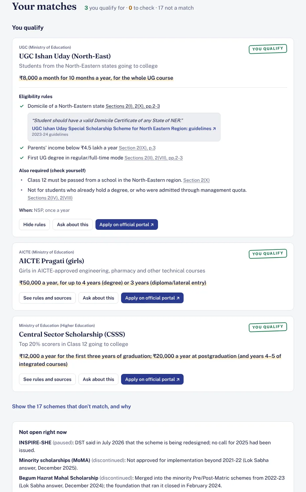
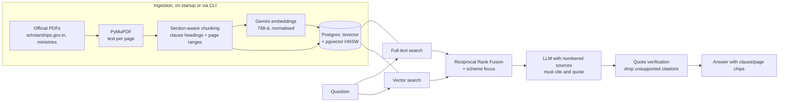

# ScholarSathi: scholarship finder with cited answers

Indian students miss scholarships they qualify for because the rules are spread across dozens of long government
PDFs. ScholarSathi does two things:

1. **Eligibility check.** Enter your category, family income, course, state and any special situation. A rule engine
   checks you against 20 central and state schemes and shows which rules you meet, which you don't, and what you still
   need to check. Every rule links to the clause of the official guideline it comes from.
2. **Ask the documents (RAG).** Ask in plain words: *"Can I take the central sector scholarship with a state
   scholarship?"* The answer is written only from passages retrieved from the official PDFs, cites the clause and page
   for every point, and says so when the documents don't cover the question.

**Live demo:** _add your Render URL here after deploying_



## How it works



### Eligibility: rules as data, not prompts

The verdict "you qualify" never comes from the language model. Each scheme in
[`data/catalog.json`](data/catalog.json) has machine-readable rules, each tied to a source document and clause:

```json
{"id": "income", "label": "Family income up to ₹4.5 lakh a year",
 "when": {"field": "income", "op": "lte", "value": 450000},
 "source": "csss-2024", "location": "Section 4(v)",
 "quote": "Students with gross parental/family income upto ₹ 4.5 lakh per annum are eligible ..."}
```

The engine ([`app/eligibility.py`](app/eligibility.py)) uses **three-valued logic**: a rule is met, not met, or
*unknown* because the student skipped that question. A blank answer never wrongly rules a scheme out; it becomes
"check these". Conditions can be nested with `all`/`any`. For example, PM Scholarship needs either a first
professional degree, or an MBA/MCA at PG level. The engine also handles exact boundaries: "up to ₹4.5 lakh" includes
₹4.5 lakh, while "below ₹4.5 lakh" (Ishan Uday) does not, and "above the 80th percentile" excludes 80.

### Retrieval: hybrid search

- **Chunking** keeps the clause structure of government guidelines ("4. Eligibility", "5.3", "IV. Benefits"). Every
  passage stores its section heading and page range, which become the citation. Headings are weighted higher in
  keyword search.
- **Keyword search** (Postgres `tsvector`, ranked with `ts_rank_cd`) catches exact terms: "80th percentile",
  "Kendriya Vidyalaya", "lateral entry".
- **Vector search** (pgvector HNSW, cosine) catches paraphrases: "my dad earns 3 lakh".
- **Reciprocal Rank Fusion** merges the two rankings without calibrating their scores. If the question names a scheme
  ("Pragati", "Ishan Uday", "single girl child"), search is focused on that scheme's documents first.
- Without an API key the app still works, using keyword search only.

### Answers: grounded and checked

The model gets numbered sources and must return JSON with an answer, a `found` flag, and **one exact quote per cited
source**. The server then checks each quote against the passage it cites ([`app/answer.py`](app/answer.py)):

- Quotes not found in the passage are rejected. Matching ignores spacing and case, but **every number in the quote
  must appear in the source**, so "₹8 lakh" can't pass for "₹4.5 lakh".
- Citation markers pointing at sources that don't exist are removed.
- If none of an answer's citations can be verified, the answer is shown with a warning.
- If the model is down or over quota, the user gets the most relevant sentences quoted straight from the documents.
- Schemes known to be discontinued or paused (e.g. the minority scholarships, INSPIRE-SHE) are passed to the model as
  status facts, so it doesn't present a closed scheme as open.

## Evaluation

[`eval/questions.jsonl`](eval/questions.jsonl) has 38 questions across all schemes, from direct ("What is the age
limit for the National Overseas Scholarship?") to situational ("I lost both my parents to covid and study diploma
engineering…"). Each lists the expected scheme and key phrases that should appear in the retrieved text.

```bash
python -m app.cli eval            # hit@1, hit@3, hit@6, MRR, key-phrase recall, latency
python -m app.cli eval --answers  # + found rate and verified-citation rate of generated answers
```

On a deployed instance: `GET /api/admin/eval` with header `X-Admin-Token`.

Measured on the 15 official PDFs that downloaded (753 passages), keyword search only, no API key. Questions about
the 6 documents that couldn't be fetched are skipped, leaving 29:

| Metric (29 questions, k=6) | Keyword only |
|---|---|
| Scheme hit@1 | 0.97 |
| Scheme hit@3 | 1.00 |
| MRR | 0.98 |
| Key-phrase recall@6 | 0.76 |
| Search latency | ~6 ms |

## Sources

21 official documents: guidelines on scholarships.gov.in and ministry websites, plus Lok Sabha answers for the
status of discontinued schemes. The Sources page in the app shows each document's version and indexing status. Notes:

- Some official PDFs are scanned images with no text layer (e.g. the MoSJE copy of the SC post-matric guidelines).
  Where possible the catalog points to a readable official copy hosted by a state government. Scanned files are
  detected and reported, not silently indexed as empty.
- Several guideline periods formally ended in 2025-26 while the schemes still run in 2026-27. Each scheme card says so.
- The research notes behind every rule (quotes, sections, caveats) are in
  [`data/research/scheme_research.json`](data/research/scheme_research.json). `tools/build_catalog.py` regenerates the catalog.

## Run it locally

Needs Python 3.12+, Node 20+ and PostgreSQL with [pgvector](https://github.com/pgvector/pgvector).

```bash
pip install -r requirements-dev.txt
createdb schemes
cp .env.example .env              # add a free Gemini key from https://aistudio.google.com/apikey (optional)
python3 tools/download_sources.py # fetch the official PDFs into data/raw/
python -m app.cli ingest          # parse, chunk, embed, index
(cd web && npm install && npm run build)
uvicorn app.main:app --reload     # http://localhost:8000
pytest                            # 32 tests: rules, parsing, chunking, retrieval, grounding, API
```

## Deploy for free (Render + Neon + Gemini)

1. **Database:** in [Neon](https://neon.tech), create a project or a new database and copy its connection string.
   pgvector is available; the app enables it.
2. **API key:** create a free key at [Google AI Studio](https://aistudio.google.com/apikey).
3. **Official PDFs:** run `python3 tools/download_sources.py` on your own computer and commit `data/raw/`.
   Some government sites block cloud servers and non-Indian IPs.
4. **App:** on [Render](https://render.com), choose **New → Blueprint**, pick this repo, and paste `DATABASE_URL` and
   `GEMINI_API_KEY`. The Docker image builds the React app, and the server migrates the database and indexes the
   documents in the background on first start.

## Project layout

```
app/
  eligibility.py      three-valued rule engine over the catalog
  ingest/             fetch → parse (PyMuPDF) → section-aware chunks → embeddings → Postgres
  retrieval.py        full-text + pgvector search, RRF fusion, scheme focus, diversification
  answer.py           prompt, JSON answer, quote verification, extractive fallback
  llm.py              Gemini / OpenAI-compatible clients with retries; offline test embedder
  evaluate.py         retrieval and answer metrics
  main.py             FastAPI routes + serves the web app
data/catalog.json     schemes, rules, source documents
eval/questions.jsonl  evaluation set
web/                  React + TypeScript + Tailwind front end
tests/                pytest suites (generated PDFs, no network needed)
```

## Limitations

- Scanned PDFs need OCR before they can be indexed: put an OCR'd copy in `data/raw/<doc id>.pdf`.
- Amounts and deadlines change every year. The app shows the version of each document, and students should confirm on
  the official portal.
- State coverage is limited to one state scheme so far. Adding a scheme means adding its document and rules to the catalog.
